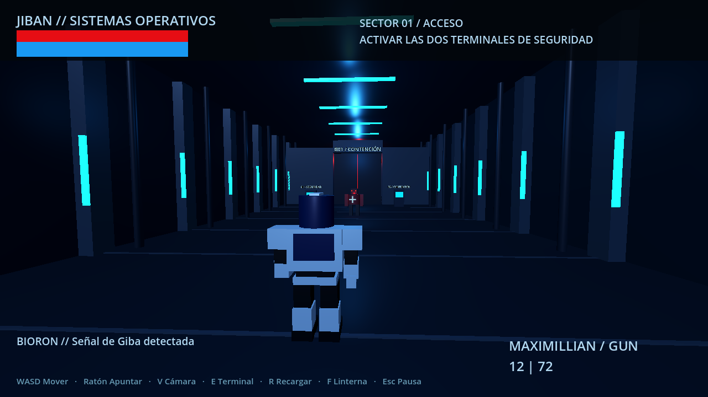
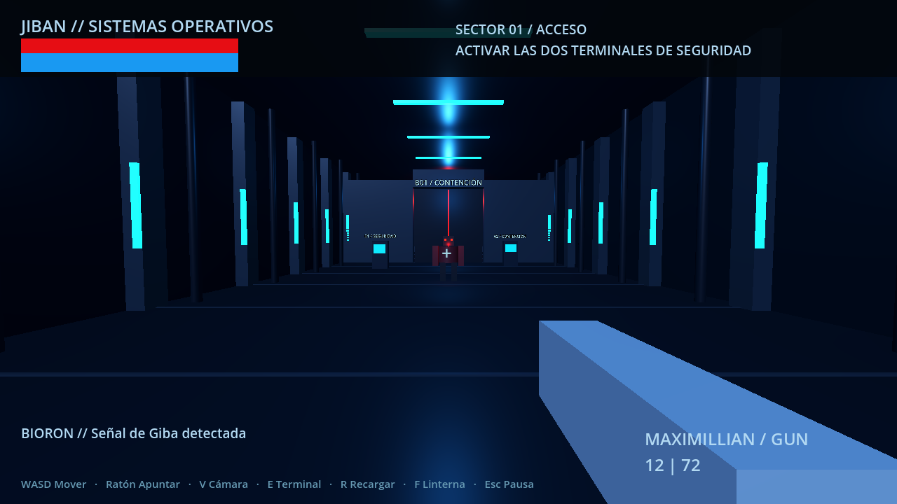

# JIBAN: La Torre de Bioron

Prototipo de acción 3D en Godot. Primera entrega técnica basada en el prompt maestro del proyecto: ingreso a una torre industrial de Bioron, disparos y cámaras intercambiables.

## Ejecutar en PC

1. Descargar **Godot 4.5.1 Standard** (GDScript, sin .NET) desde https://godotengine.org/download/archive/4.5.1-stable/.
2. Descargar o clonar esta rama del repositorio.
3. En Godot, seleccionar **Importar**, elegir `project.godot` y abrirlo.
4. Pulsar **F6** con `scenes/main.tscn` abierta o **F5** para ejecutar el proyecto.

No requiere modelos, plugins ni otros paquetes. No contiene todavía un ejecutable exportado ni una versión Android. El renderizador Compatibility prioriza compatibilidad; no se ha medido rendimiento en un PC de usuario.

## Objetivo del recorrido

Neutralizar el primer Bionoid, acercarse a cada una de las dos terminales y apuntar a su pantalla para activarla. Se abre la compuerta y se registra un punto de control en memoria. Atravesar la contención, derrotar a los enemigos restantes y activar el elevador al fondo para terminar. Es una zona de prueba corta, **no la demostración completa de 10–15 minutos** prevista en el diseño.

## Controles

| Acción | Teclado / ratón | Mando |
|---|---|---|
| Movimiento | WASD | Stick izquierdo |
| Mirar | Ratón | Stick derecho |
| Disparar | Botón izquierdo | Gatillo derecho |
| Apuntar | Botón derecho | Gatillo izquierdo |
| Saltar | Espacio | A |
| Correr | Shift | Pulsar stick izquierdo |
| Interactuar | E | X |
| Recargar | R | B |
| Cambiar cámara | V | Y |
| Linterna | F | Pulsar stick derecho |
| Pausa | Esc | Start |

La pausa incluye sensibilidad del ratón y reinicio. Asignaciones de mando implementadas, pendientes de prueba con hardware físico. Aún no hay remapeo ni persistencia de ajustes.

## Implementado

- Personaje provisional con silueta azul/plata, visor rojo y animación sencilla de marcha.
- Movimiento con aceleración, gravedad, salto, carrera y energía.
- Primera persona con arma visible y tercera persona con cámara que evita paredes.
- Ambas perspectivas convergen en el objetivo del visor; el disparo se resuelve desde el cuerpo y respeta obstáculos.
- Maximillian Gun: cargador, reserva, recarga, daño, destello, traza y sonido sintetizado original.
- Bionoid de asalto y variante pesada: detección visual, persecución directa, ataque, daño y muerte.
- Sector modular con terminales, compuerta, iluminación industrial y cápsulas provisionales.
- HUD con datos reales, misión, muerte, pausa, reinicio y final del sector.
- Punto de control **en memoria durante la sesión**.

## Validación

Comprobado con Godot 4.5.1: arranque y 23 comprobaciones automáticas de movimiento, salto, cámaras, disparos, obstáculos, recarga, IA, terminales, muerte, reinicio y finalización. Ver `docs/VALIDATION.md`.

```bash
godot --headless --path . --editor --import --quit
godot --headless --path . --script res://tests/smoke.gd
```

`tests/visual.gd` permite renderizar capturas de ambas perspectivas en `exports/` con una pantalla y OpenGL disponibles. No usar `--headless` para esa prueba visual.

## Pendiente

Modelos y animaciones definitivas, prólogo con las imágenes, Sword/Stick, jefes, navegación por malla, audio ambiental espacial, sustos elaborados, guardado en disco, ajustes persistentes, optimización y exportaciones. La IA actual funciona en las rutas despejadas de esta zona, pero **no sabe planificar un rodeo alrededor de obstáculos**.

Los gráficos son un bloqueo inicial con primitivas. Las imágenes proporcionadas marcan la dirección artística futura; no son capturas de este prototipo.

## Recursos y propiedad intelectual

Prototipo de fan para evaluación privada. Jiban y personajes asociados pertenecen a sus titulares. No se presupone autorización de distribución o comercialización. La geometría y el pulso sonoro de esta entrega se generan por código; no se incorporan recursos extraídos de otros juegos ni música de la serie. Véase `docs/ASSETS.md`.

## Capturas reales del prototipo




